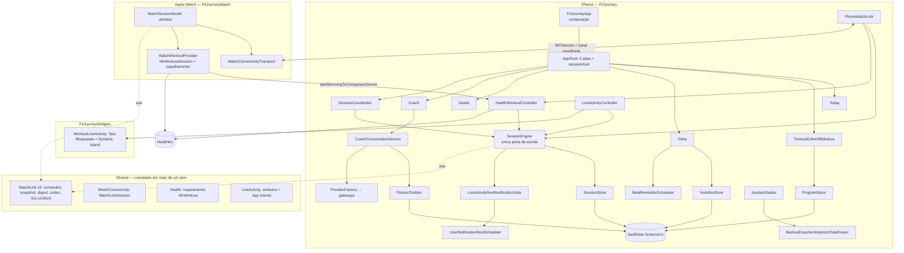
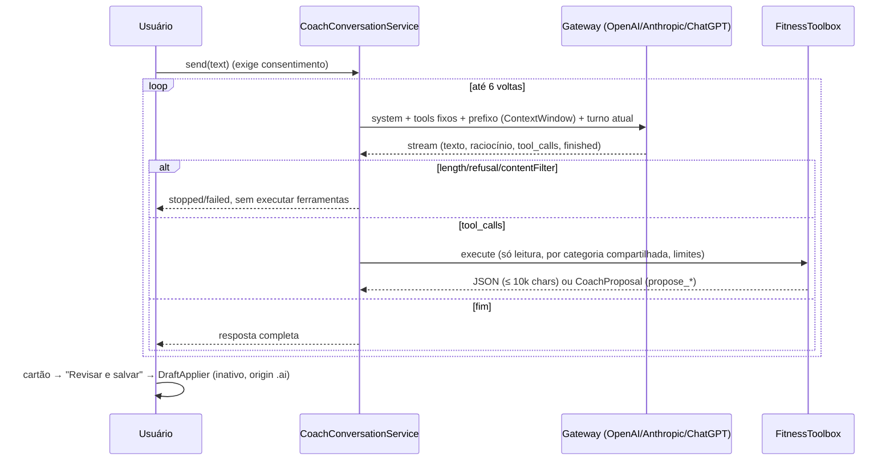

# Codebase Map — FitJourney

> Gerado pelo Cartographer em 2026-11-11 (commit `377f289`; atualizado em `f958e9b` com P6.7 e P5.6). Estado e pendências: `work/STATUS.md`. Comportamento: `SPEC.md`. Plano: `docs/PLANO.md`. IA: `docs/ia.md`. Design: `DESIGN_DIRECTION.md`.

App iPhone (SwiftUI, Swift 6 com concorrência `complete`, SwiftData, HealthKit, iOS 26+, Liquid Glass, sem dependências de terceiros) para planejar e registrar treinos de academia e dieta, com app do Apple Watch que controla a sessão, Live Activity/Dynamic Island, Apple Health e Coach de IA (OpenAI, Anthropic, OpenRouter, endereço próprio e ChatGPT por login — experimental). pt-BR principal, en completo.

## Visão geral



## Estrutura

```
FitJourney/               app iOS
  App/                    FitJourneyApp (composição), AppRoot (abas, reset), AppNotificationDelegate
  Domain/                 regras puras (Foundation): treino, prescrição, agenda, sessão, métricas, nutrição, saúde, RestPolicy, AppCalendar
  Persistence/            @Model (SwiftData), Stores (Program/Session/Nutrition), Seed (catálogo, exemplo ABC), PersistenceController
  Services/
    Session/              SessionEngine, tombstones, WatchLinkMapping (snapshot/digest), notificação de descanso
    Watch/                PhoneWatchLink
    LiveActivity/         controlador, mapper, gate, cliente ActivityKit
    Health/               autorização, HealthWorkoutController, HealthQueries, HealthKitStore
    AI/                   Core, HTTP, Providers, ChatGPT, Secrets, Tools, Drafts
    Backup/               export/import/apagar, zip próprio, schema embutido
    Media/                MediaStore, MediaMaintenance, MediaImageLoader
    Notifications/        lembretes de refeição, registro de categorias
  Features/               Today, Programs, RoutineEditor, Exercises, Session, History, Nutrition, Health, Coach, Settings
  DesignSystem/           Tokens, Modifiers (fjGlass, fjCard, FJFlowLayout), Components, Gallery
Shared/                   WatchLink, WatchConnectivity, Health, LiveActivity
FitJourneyWatch/          app watchOS (App, Model, Health, Views, DesignSystem, Previews)
FitJourneyWidgets/        extensão: Live Activity + Dynamic Island
FitJourneyTests/          ~700 testes (Swift Testing) · FitJourneyWatchTests/ 64 testes
contracts/                JSON Schemas versionados: program-draft-v1, nutrition-plan-draft-v1, fitjourney-export-v1 (+ exemplo)
docs/ · design/ · work/   plano, IA, mapa · protótipo HTML e ícone · STATUS e evidências
.claude/agents/           fit-supervisor, ios-design (Fable), core-engineer (Opus), ios-implementation/review-code/qa-accessibility (Sonnet)
```

## Guia de módulos

### Domain (`FitJourney/Domain/`)
Foundation puro, testado; `TrainingEnums`, `HealthAnalysis` e `HealthWorkoutType` também compilam no relógio.

| Arquivo | Propósito |
|---|---|
| `TrainingEnums.swift` | Enums persistidos por `rawValue` String (nunca renomear). |
| `Prescription.swift` | `RepTarget` (fixo/faixa/AMRAP), `Load` (peso ou peso corporal ± delta, unidade nativa), `EffortTarget`, `CardioTarget`, `RoutineEstimate`. |
| `RestPolicy.swift` | `set ?? routineExercise ?? exercise ?? fallback` (fallback = Ajustes). `nil` = próximo nível; `0` é válido. |
| `AppCalendar.swift` | Calendário do app com `firstWeekday` de `fj.weekStart` (segunda padrão); só afeta semanas, não os dias gravados. |
| `ScheduleResolver.swift` | Treino do dia (livre: menos recente; sequencial: âncora na última concluída, circular; semanal: dia ou descanso), `nextWorkout`, `weeklyAdherence`. |
| `SessionClock.swift` / `SessionFlow.swift` | Tempo por datas (pausa, descanso) · exercício atual (foco, rodadas de bi-set/circuito), `isEndOfRound`, treino esquecido (> 4 h). |
| `CurrentLoadPolicy.swift` · `WorkoutMetrics.swift` · `ProgressionSuggestion.swift` | Propostas de carga atual ao finalizar · volume (reps ausentes = piso, estimado), Epley, recordes · progressão opcional. |
| `Media.swift` | `MediaRef`, `VideoLinkParser` (YouTube/Vimeo). |
| `Nutrition*.swift` | Totais (desconhecido ≠ zero), vigência do plano, regras de edição, parser numérico pt-BR, aderência, apresentação pura. |
| `Health*.swift` | Zonas/estatísticas/`HealthReading` (sem dados ≠ indisponível ≠ zero), tipo do treino, matcher/dedupe de treinos. |

### Persistence (`FitJourney/Persistence/`)
- **SchemaV1** com 17 modelos (treino, sessão, dieta, chat), sem stages de migração; CloudKit-compatível (padrões/opcionais, sem `.unique`, relações opcionais com `deleteRule`), `cloudKitDatabase: .none` por ora. Enums em `…Raw`, compostos em `…Data` JSON via `StorageCoding` (leitura tolerante, preserva desconhecidos).
- **Treino**: `TrainingProgram → Routine → RoutineExercise → SetPrescription` (cascade); `Exercise` do catálogo com nullify. `initialLoad` imutável pela execução; `currentLoad` só ao finalizar com confirmação — exceto a **primeira definição** (ficha sem carga ou com peso 0), aplicada sempre (P2.8).
- **Sessão**: `WorkoutSession → SessionExercise → SetLog` (cascade) com **snapshot da prescrição** no início; campos do motor (`revision`, `appliedCommandIDsData`, `lastCommandAt`, `holdStartedAt`, `restTotalSeconds`, notas/dor com carimbos).
- **Invariantes só em código**: um programa ativo, uma dieta ativa, uma sessão em andamento (`ProgramStore.activate`, `NutritionStore.switchActive`, `SessionStore.start` + `SessionEngine`).
- **Seed** versionado e idempotente (`catalogKey`, `addedInVersion`); exercício embutido apagado não volta. Descanso do catálogo opcional (nil = padrão dos Ajustes).

### Motor da sessão (`Services/Session/SessionEngine.swift`)
`@MainActor @Observable`, **única porta de escrita** da sessão (UI via `SessionCoordinator.send`, relógio via `PhoneWatchLink`, intents da Live Activity). Detalhes em "Fluxos".

### Relógio ↔ iPhone (`Shared/WatchLink`, `Services/Watch/PhoneWatchLink.swift`, `FitJourneyWatch/Model`)
Protocolo v2, iPhone fonte de verdade, relógio otimista. Detalhes em "Fluxos".

### Live Activity (`Services/LiveActivity`, `Shared/LiveActivity`, `FitJourneyWidgets`)
Uma atividade por sessão; atualiza só quando o estado muda; contagens desenhadas pelo sistema (`Text(timerInterval:)`); `staleDate = restEndsAt`; intents +15 s/Pular rodam no processo do app; gate evita aviso duplo com a notificação local.

### Saúde (`Services/Health`, `Features/Health`)
Autorização contextual; sessão ao vivo no iPhone (iOS 26) ou gravação simples no fim; espelhamento do relógio com marca persistida (nunca grava duplicado); reconciliação; `HealthQueries` com `HealthReading` (nunca zero). Aba Saúde: dia, tendências, gráfico de FC por exercício, vínculo com treino do Watch (alta = automático com Desfazer; incerta = pergunta).

### Coach de IA (`Services/AI`, `Features/Coach`, `Features/Settings/AISettingsView.swift`)
Gateways OpenAI-compatível, Anthropic nativo e ChatGPT (login, experimental); laço de ferramentas locais com consentimento por categoria (tudo desligado por padrão); propostas validadas por JSON Schema e aplicadas só por "Revisar e salvar" (inativas, `origin = .ai`); segredos só no Keychain.

### Backup (`Services/Backup`, `Features/Settings/DataSettingsView.swift`)
Formato `fitjourney-export-v1` (JSON puro ou `.fitjourney` zip com mídia); importar mesclando ou substituindo, transacional; apagar tudo.

### UI (`App/`, `Features/`, `DesignSystem/`)
- `AppRoot`: Hoje · Treinos · Dieta · Saúde · Coach; `sessionHost` (fullScreenCover da sessão, acessório `tabViewBottomAccessory`, treino esquecido, hápticos); reset em duas fases.
- Padrão: lógica de apresentação pura e testável em `*Presentation.swift`/`*Logic.swift`; `@Query` para listas; preferências `fj.*` via `@AppStorage`/`AppPreferenceKeys`; kg/lb só na exibição (`LoadDisplay`).
- DesignSystem: `FJColor` (áreas treino laranja/dieta/saúde/coach, zonas 1–5), `FJRoutineColor` (8 cores de ficha, AA), `FJFont` (Dynamic Type, números SF Rounded mono), `FJSpacing/FJRadius/FJSize` (44 pt mínimo), `FJMotion` (Reduzir Movimento), `FJHaptic`; **vidro só no que flutua** via `fjGlass` (sólido com Reduzir Transparência); componentes `FJPrimaryButton`, `FJRestTimerView`, `FJCheckButton`, `FJRPEScale`, `FJSessionAccessory`, `FJMetricCell` ("—" para nil), `FJRoutineBadge`, `NumberStepperField`…

## Fluxos

### Sessão de treino (comandos idempotentes)

```mermaid
sequenceDiagram
  participant UI as SessionView / Relógio / Intent
  participant E as SessionEngine
  participant S as SessionStore (autosave off)
  participant DB as SwiftData
  UI->>E: SessionCommand(commandID, sessionID, issuedAt, kind)
  E->>E: commit pendente? tombstone? dedupe (200 IDs)
  E->>E: validar estado/valores; at = clamp(issuedAt, startedAt…now)
  E->>S: mutação (touch por série: ignora at < lastCommandAt)
  E->>DB: um único save (mutação + commandID + revision++)
  alt save falhou
    E-->>UI: rejected(persistenceFailed) e guarda PendingCommit
  else ok
    E-->>UI: applied(revision, events) · publica SessionSnapshot
    E->>E: syncRest (notificação/timer por datas), eventos
  end
```

- Descanso, pausa, sustentação/cardio derivam de datas; pausa desloca `holdStartedAt`/`restEndsAt`; `restFinished` emitido uma vez (tolerância 30 s).
- Treino esquecido: `staleSessionPrompt` (finalizar na última série / continuar / descartar). `discard` apaga o registro e deixa tombstone (5 últimas).
- Encerrar: resumo e snapshot terminal calculados antes do save; aplica as propostas de carga confirmadas + as de primeira definição (`LoadUpdateProposal.isFirstDefinition`, também pelo relógio e no treino esquecido); humor/nota.
- Memória de carga (P2.8): `plannedLoad` = carga da ficha se definida (peso 0 = vazia; peso corporal 0 vale), senão `SessionStore.lastUsedLoad` (última série concluída com carga do exercício, qualquer ficha, do mesmo tipo: aquecimento nunca alimenta válida), senão `nil` ("Definir carga" no iPhone/relógio, nunca "0 kg") — vale para início, `addExercise`, `addSet`, substituição e `adjustLoad` sem base. Concluir/ajustar uma série propaga a carga às seguintes pendentes não editadas do mesmo exercício que mostravam a mesma carga (`propagateLoad`; espelhado no `SessionReducer`).

### Relógio ↔ iPhone (WatchLink v2)
- **IDs determinísticos** UUIDv5 com namespace = `sessionID` (`exercise:`, `set:`, `extra-set:`, `added-exercise:`, `added-set:`) — o relógio cita séries antes do 1º snapshot sem retenção.
- **Canais** (ordem): canal da `HKWorkoutSession` espelhada → `sendMessageData` com resposta → `applicationContext` (digest + snapshot + carimbo) / `transferUserInfo` (fila offline). Buffers antes da ativação; `.incompatible` só em canal ativo.
- **iPhone**: aplica via `engine.apply`, responde `commandReply`, coalesce snapshots (250 ms, terminal imediato), digest só quando programas mudam (debounce 2 s), `.saved` do relógio → `linkWorkout` (pendências persistidas; após 10 min busca no Saúde por `ExternalUUID`).
- **Relógio**: `display = confirmed + pending` reaplicados pelo `SessionReducer`; poda por `appliedCommandIDs` e por IDs inexistentes (somando os que `addSet/addExercise` vão criar); reenvio a cada 5 s com o mesmo `commandID`; coalescência da Coroa (0,35 s) só para comando nunca enviado; digest/snapshot em cache para abrir offline.
- **Alerta de fim de descanso** (`fj.restAlertRepeat`, padrão ligado): relógio — `WatchSessionModel.restAlert` + `WatchHapticLoop`/`WatchRestAlertPattern` (laço até `silenceRestAlert()`/`startSetAfterRest()` ou 60 s; tela `RestAlertView` no lugar da sessão; a preferência chega em `SessionSnapshot.restAlertRepeat`, só `false` quando desligada); iPhone — `SessionCoordinator.restAlert`/`activeRestAlert` + `FJAlertVibrating`, cartão `FJRestAlertCard` sobre a doca só com a `SessionView` à vista (`restAlertHostReady`). "Começar série" envia `skipRest` (fecha o alerta do outro aparelho); parar não envia nada. Com o pulso abaixado o laço do relógio depende da `HKWorkoutSession` do relógio.
- **Quem grava no Saúde**: iniciado no relógio → relógio grava (`.recording` antes do `start`); iniciado no iPhone → iPhone grava, relógio controla (pode pedir "Gravar no relógio").

### HealthKit e espelhamento
- iPhone: `HealthWorkoutController.attach(to: engine)` segue os eventos; ordem obrigatória eventos/metadata/energia → `endCollection` → `finishWorkout`; falha → gravação simples; sessão espelhada marcada nunca é regravada; espelho caído = `.mirrorDisconnected` (não retoma gravação local); reconciliação de sessões sem treino (7 dias, uma vez); `unlinkWorkout` marca como reconciliada.
- Início automático (P2.8, `Services/Watch/WatchAutoStarter.swift`): sessão iniciada no iPhone + `fj.autoStartWatchWorkout` (padrão ligado) + app do relógio instalado + Saúde com escrita → `HKHealthStore.startWatchApp(with:)` (`WatchAppLaunching`). O relógio recebe em `WatchAppDelegate.handle(_ workoutConfiguration:)` → `WatchSessionModel.handlePhoneWorkoutLaunch()` grava a sessão do próximo snapshot (≤ 90 s) pelo fluxo "gravar no relógio" — ou exatamente a do `recordingRequest(sessionID)` que o iPhone manda assim que o relógio fica alcançável; o iPhone adota a gravação ao receber `.recording`. `startWatchApp` sem resposta (10 s), falha ou sem confirmação (20 s) → o iPhone segue gravando; tentativa em tarefa própria por sessão.
- Relógio: `WatchWorkoutProvider` — `stopActivity` → espera `.stopped` (≤ 5 s) → eventos/metadata (`ExternalUUID`) → `endCollection` → `finishWorkout` → `end()` → `.saved(id)` durável; fim externo grava o coletado; recuperação via `handleActiveWorkoutRecovery` com contexto persistido.

### Coach de IA



- Thinking só reenviado no turno atual; resultados de ferramenta antigos compactados (> 3 turnos); retry 429/503/529 antes do stream; Markdown do modelo sem links.
- ChatGPT (login): OAuth PKCE, listener loopback `localhost:1455` (uso único, `state` em tempo constante, timeout), tokens só no Keychain, refresh serializado, Responses API com function calling. **Não oficial** — pode parar a qualquer momento.

### Dieta e lembretes
- Dia em linha do tempo (feita/ajustada/pulada/"Sem registro"), registro avulso, água, totais × metas; vigência resolve o plano que cobre o dia (fora dela: só avulsos).
- `MealReminderScheduler`: janela rolante de 14 dias (≤ 60 pendentes), gatilhos de data completa não repetidos, idempotente e serializado, refeito no launch/foreground/edições; desligado em `fj.mealReminders`; ação "Marcar como feita" via `AppNotificationDelegate` (só se a refeição está pendente e no plano). `NotificationCategoryRegistry` é o dono único das categorias.

### Backup
- Exportar (ator, fora da main): `data.json` + mídia stored; nunca lê o Keychain; arquivo temporário protegido, apagado ao fim do compartilhamento e após 24 h.
- Importar: tamanho (96 MiB) → versão → schema → Codable → saneamento; mídia só a referenciada, limites por arquivo e total (3 GiB), inflate em blocos; um único save; mesclar por agregado (`updatedAt`) ou substituir (recusado com treino em andamento). **Nunca importa** provedor/URL do Coach, consentimento, segredos, sessões em andamento ou links com credenciais.
- Reset em duas fases na UI: `.fjDataWillReset` (abas viram estado neutro, sessão minimizada, Coach para) → operação → `.fjDataDidReset` (abas recriadas, `engine.restore()`).

## Convenções
- Swift 6 `complete`, `@MainActor` nos serviços; callbacks de sistema `nonisolated` saltando para a main; protocolos nas bordas com fakes (`WatchLinkSession`, `HealthStoreProtocol`, `LiveActivityClient`, `SecretStore`, `MealReminderNotificationCenter`).
- Tempo sempre por datas persistidas; "ausente ≠ zero" em saúde, nutrição e export; enums de fio com `.unknown`.
- Contratos JSON copiados verbatim para Swift (`DraftSchemas`, `BackupSchema`) com teste de identidade.
- Idioma (P6.8): Ajustes › Geral › Idioma (`AppLanguagePreference`, `fj.appLanguage` + `AppleLanguages`, vale ao reabrir). `AppLanguageCode` (Shared) dá o idioma efetivo ("pt-BR"/"en"), enviado em `ProgramDigest.language`/`SessionSnapshot.language` (opcionais); o relógio aplica em `WatchSessionModel.applyLanguage`. Nomes de exercício do catálogo: `String.exerciseDisplayName` (`ExerciseCatalogIndex`) na UI, e já localizados em digest/snapshot (relógio, Live Activity) e no `FitnessToolbox`.
- Strings em `Localizable.xcstrings` (pt-BR fonte, en completo; catálogo próprio no relógio; `InfoPlist.xcstrings`); testes rodam em pt-BR (schemes).
- Processo: pacotes em worktrees, revisão independente antes de integrar, um simulador por agente (`FJ-<pacote>`), desligar só o próprio.

## Armadilhas
- `rollback()` do SwiftData não desfaz modelos em memória — por isso o commit pendente no motor.
- Janela de dedupe finita (200 na sessão, 64 no snapshot, 5 sessões nos tombstones); comandos de série antigos viram no-op por `issuedAt`.
- Prefixos/codificação de `WatchLinkIDs` e `rawValue`s persistidos são imutáveis; mudar o fio exige subir `schemaVersion`.
- `AppCalendar` devolve cópia com `firstWeekday` fixo — releia a cada uso.
- Em `SessionStore.completeSet` o descanso do exercício da sessão já inclui o do catálogo (chamada passa `exercise: nil`).
- Live Activity: ActivityKit não tem alerta silencioso (som desligado = sem alerta, notificação silenciosa); request só em primeiro plano (retry no foreground).
- HealthKit: leitura negada é indistinguível de "sem dados"; nada disso valida no simulador.
- `get_health_summary` (`FitnessToolbox+Health.swift`) só com `Sharing.health`; sem `Sharing.workouts` as sessões do app ficam de fora; campos sem leitura vêm `null` + `status` (nunca zero); dia corrente é parcial e fica fora das médias.
- `docs/ia.md` lista itens do plano não portados (`GeminiGateway`, `GatewayRouter`) — Gemini só via OpenRouter.
- Zip sem Zip64 (4 GB, 65.535 entradas). `.xcodeproj` não é versionado (`make project`). Team de assinatura só por variável (`make device TEAM=…`).
- Alerta de fim de descanso: o watchOS não entrega botão lateral/clique da Coroa ao app (só giro, toque e toque duplo param o laço); sem gravação no relógio o app é suspenso com o pulso abaixado; a mudança de `fj.restAlertRepeat` só chega ao relógio no snapshot seguinte.
- Tokens do relógio (`WF`) espelham os do iPhone manualmente; a extensão compila 4 arquivos de tokens e o catálogo do app.

## Guia de navegação
- **Novo comando da sessão**: `Shared/WatchLink/SessionCommand.swift` → `SessionEngine.perform/apply` → `SessionStore` → `SessionSnapshotBuilder` (se o relógio precisa ver) → `SessionReducer` do relógio → UI (`Features/Session`) → testes `SessionEngine*Tests`, `WatchLinkV2Tests`.
- **Novo campo persistido**: `Persistence/Models` (padrão ou opcional) → backup (`BackupFormat`, `BackupMapping`, `contracts/fitjourney-export-v1.schema.json` + `BackupSchema.swift`) → testes de ida e volta.
- **Nova ferramenta do Coach**: `Services/AI/Tools/FitnessToolbox.swift` (schema estrito, limites, categoria de consentimento) → `CoachPrompt` se necessário → `AIToolboxTests`.
- **Novo provedor de IA**: `ProviderCatalog`, `ProviderFactory`, gateway em `Providers/` → `AISettingsView`.
- **Nova tela**: `Features/<Área>/` usando `DesignSystem` (tokens, `fjGlass` só no que flutua) + strings no catálogo + `*Presentation` testável.
- **Mudança visual/tokens**: `DESIGN_DIRECTION.md` (dono: `ios-design`) → `DesignSystem/` → espelhar em `FitJourneyWatch/DesignSystem/WatchTheme.swift` se afetar o relógio.
- **Rodar no aparelho**: `make device TEAM=<TEAM> DEVICE_ID=<udid>` (`xcrun devicectl list devices`).
